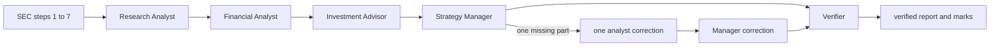

# FIN 67110 SEC agent desk

This is the student's existing seven-step SEC desk with a Week 3 LangGraph team added. The older Checkpoint 1 fallback reports and audits remain in place. The four role instructions are in `roles/`. The three analyst files are working instructions from Lab 03; they are **not** the student-written Lab 05 personas.

## What runs



Code fixes the node order and input to each role. The model writes the analysis within each role. The Manager has one correction slot. A role and the Manager each run at most twice. A completed full run always goes through the Verifier. `--verify-only` runs only the Verifier on an existing saved run.

Each full run creates a new company/date/time folder in `runs/`. It saves `facts.json`, the four filing texts, `node_order.log`, each node's input and output, `report.md`, `marks.json`, and `verified_report.md`. The mark table is directly under the verified report's first filing line. The automated marks are separate from a student's audit and a partner's checks.

## Setup and commands on Windows PowerShell

Python 3.12.14, OpenAI SDK 3.46.0, and LangGraph 1.2.20 were installed locally on 2026-11-05. To install from scratch with `uv`:

```powershell
uv venv --python 3.12 .venv
uv pip install --python .venv\Scripts\python.exe -r requirements.txt
```

Put your own developer key in the ignored `.env` file as `API_KEY=...`. Keep the `SEC_USER_AGENT=...` entry. Do not paste either value into a report or commit it. A full team run stops before it fetches data until a key authenticates.

```powershell
.venv\Scripts\python.exe app.py COST --peers WMT,TGT,BJ --price 896.48 --price-date 2026-09-24
.venv\Scripts\python.exe app.py --verify-only runs\YOUR_SAVED_RUN_FOLDER
.venv\Scripts\python.exe prepare_proofs.py runs\YOUR_SAVED_RUN_FOLDER
```

The $896.48 close and 2026-09-24 date come from the student's saved Lab 03 COST report. The report links its external price sources. This is a historical pre-release close, not a current quote.

## Current proof and limits

Two completed COST team runs are saved in `runs/COSTCO_WHOLESALE_CORP_NEW_2026-11-08_17-08-10-0500/` and `runs/COSTCO_WHOLESALE_CORP_NEW_2026-11-08_17-13-21-0500/`. Both used WMT, TGT, and BJ, with the saved $896.48 price dated 2026-09-24. Both ran data steps, Research Analyst, Financial Analyst, Investment Advisor, Strategy Manager, and Verifier in that order. Each has its own filing texts, facts, node inputs and outputs, `report.md`, `marks.json`, and `verified_report.md`. The 11 core claims and 9 peer figures are marked correct in both runs. The first run's `node_order.log` has later Verifier entries from `--verify-only` calls; its first six entries are the full-run order. Later `--verify-only` calls use `verify_only.log`.

| Evidence | Saved result |
|---|---|
| First team run | [Verified report](runs/COSTCO_WHOLESALE_CORP_NEW_2026-11-08_17-08-10-0500/verified_report.md) · [marks](runs/COSTCO_WHOLESALE_CORP_NEW_2026-11-08_17-08-10-0500/marks.json) · [node order](runs/COSTCO_WHOLESALE_CORP_NEW_2026-11-08_17-08-10-0500/node_order.log) |
| Second team run | [Verified report](runs/COSTCO_WHOLESALE_CORP_NEW_2026-11-08_17-13-21-0500/verified_report.md) · [marks](runs/COSTCO_WHOLESALE_CORP_NEW_2026-11-08_17-13-21-0500/marks.json) · [node order](runs/COSTCO_WHOLESALE_CORP_NEW_2026-11-08_17-13-21-0500/node_order.log) |
| Seeded EPS error | [Verified report](runs/lab04_proofs/COSTCO_WHOLESALE_CORP_NEW_2026-11-08_17-08-10-0500_2026-11-08_17-15-39-0500_seeded_eps/verified_report.md) · [marks](runs/lab04_proofs/COSTCO_WHOLESALE_CORP_NEW_2026-11-08_17-08-10-0500_2026-11-08_17-15-39-0500_seeded_eps/marks.json) |
| Invented growth error | [Verified report](runs/lab04_proofs/COSTCO_WHOLESALE_CORP_NEW_2026-11-08_17-08-10-0500_2026-11-08_17-15-39-0500_invented_growth/verified_report.md) · [marks](runs/lab04_proofs/COSTCO_WHOLESALE_CORP_NEW_2026-11-08_17-08-10-0500_2026-11-08_17-15-39-0500_invented_growth/marks.json) |

The seeded copies of the first completed team run are in `runs/lab04_proofs/`, with names ending in `2026-11-08_17-15-39-0500_seeded_eps` and `2026-11-08_17-15-39-0500_invented_growth`. In the first copy, annual diluted EPS was raised from $20.76 to $21.76 and a false quotation was added; the saved 10-K was unchanged. Code and model marked it wrong and the verified report supplies $20.76 with 10-K line 752. In the second copy, 14.14% growth was added although the quoted $303.154 billion and $275.235 billion annual revenues give about 10.14%; code and model marked it wrong and the verified report shows the arithmetic. The copies' filing texts and facts are byte-for-byte equal to the source run.

The code checks the 11 core rows, peer table figures, and growth sentences with two quoted dollar inputs. The model checks cited lines it receives for period and definition. These automated checks do not certify every other number, the Investment Advisor's thesis, or whether an otherwise true claim answers the client's question. If OpenAI returns 429 on `--verify-only`, code marks remain available and the model check is labeled pending.

The previous `audit_COST.md` and `audit_MSFT.md` are AI-assisted audits. They do not record a student hand audit or a partner sign-off. The clean-report Lab 04 condition requires the student to check and correct all 11 core claims personally before treating that proof as complete.

## Lab 05 work for the student

Write the Research Analyst, Financial Analyst, and Investment Advisor personas yourself, in the six parts on the [Week 3 page](https://cinderzhang.github.io/FIN67110-Fall2026/week-03/index.html). Keep the Manager's checklist. Then add an `Insight:` line check that returns a missing or headline-only insight to its role once. Have a partner choose a U.S. company that reported this month, run it, and ask the partner to check two core claims by hand. The page UI must accept ticker, optional peers, and price, show each node as it runs, and show the verified report and marks without a terminal. No UI or student persona is present yet.

Checkpoint 2 requires a Brightspace submission of a permalink to a repository commit that holds the agent team and the Verifier's marks on the seeded EPS error. The public [grading page](https://cinderzhang.github.io/FIN67110-Fall2026/grading.html) and [schedule](https://cinderzhang.github.io/FIN67110-Fall2026/schedule.html) still show the original 2026-11-05 deadline. The student reports that the deadline was moved; check Brightspace for the current date. A commit alone is not a Brightspace submission. Keep `.env`, `.venv`, `.uv-cache`, `.python`, private data, and restricted data out of the repository.

Prompt references: [OpenAI prompt engineering](https://developers.openai.com/api/docs/guides/prompt-engineering), [Anthropic prompting best practices](https://platform.claude.com/docs/en/build-with-claude/prompt-engineering/claude-prompting-best-practices), [LangGraph Graph API](https://docs.langchain.com/oss/python/langgraph/quickstart), and the instructor's [FAskills](https://github.com/CinderZhang/FAskills). FAskills is a reference, not an installed skill in this project.

This is a learning exercise, not financial advice.

AI assistance: Codex helped build and run the automated checks. Student source verification and judgments are pending.

Any remaining errors are my own.
